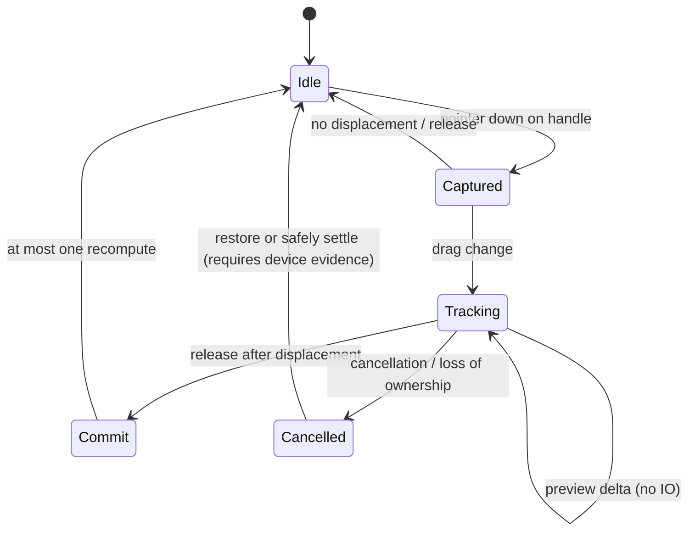

# 长截图手势交互契约与验收（2026-11-10）

基于 [Emil Kowalski / gestures](https://github.com/emilkowalski/skills/blob/main/skills/gestures/SKILL.md) 的交互原则做 Android Compose 适配，不照搬 Web 动画参数。

## 真实实现 / 本批处理

| 对象 | 当前实现与证据 | 本批目标 |
| --- | --- | --- |
| 总览切点及头尾裁剪 | `OverviewEditor.VerticalDragHandle` 使用 `awaitEachGesture` / `verticalDrag`，拖动中 `onPreviewCut` / `onPreviewCrop`，松手 `onCommit` | 48dp 命中区 + 38dp 圆点；原位释放不触发重切 |
| 精细切点 | `PreviewCutEditor` 同样按手指位移换算源坐标，外层是 `verticalScroll` | 48dp 命中区 + 38dp 圆点；保持既有操作与生成逻辑 |
| 正文滚动 | 编辑面板外层 `verticalScroll`，手柄在 Initial pass 消费按下 | 验证手柄拖动不被滚动抢占；手柄外滚动仍正常 |
| 真实裁切 | ViewModel / `SourceCutGeometry` / 导出链路另有状态机和测试 | 不通过动效修改裁切几何；保存/ZIP/分享仍要实物验收 |

## 手势状态与不变量



核心不变量：位置由当前拖动增量直接映射为源坐标；裁切顺序和上下边界不被破坏；非拖动区域正常滚动；一次有效释放最多触发一次重切。**取消手势回滚仍待明确测试**，不得把上图当作已实现证明。

## 验收矩阵

| ID | 场景 | 必须观察的结果 | 验证方式 |
| --- | --- | --- | --- |
| G01 | 单击切线而未移动 | 切点不变、不重算或重新导出 | 静态契约 + 真机日志 |
| G02 | 慢速拖动 / 反向拖动 | 切线随手指连续移动，反向无跳变，无动画追赶 | 真机录屏/帧分析 |
| G03 | 从手柄拖动 vs 从空白处滚动 | 前者只调切线，后者继续滚动 | 真机 |
| G04 | 顶部/底部及相邻切线靠近 | 不越过合法裁切边界；无重叠命中造成错切 | 几何测试 + 真机 |
| G05 | 中途取消 / 多指 / 旋转屏幕 | 不留下不一致的待提交预览状态 | 真机；当前未验证 |
| G06 | 高频连续拖动与快速释放 | 无持续落后、闪烁、重复重切或明显掉帧 | 60/120Hz 设备帧记录 |
| G07 | 按切线裁出相册、ZIP 并分享 | 输出切片顺序和像素边界与预览一致；无断字、重复上下文 | 测试图片 + 文件比对 |
| G08 | 小手柄触控 | 至少 44dp 实际命中区；视觉尺寸不必增大 | 源码静态契约 + 真机触点 |

## 运行门禁

```bash
./gradlew :app:testDebugUnitTest
./gradlew :app:assembleDebug
python3 tools/verify_state_machines.py
bash formal/longshot/verify.sh
```

`UiLayoutScreenshotContractTest` 的源码断言只能证明存在指定尺寸与提交门禁，**不证明实际 Compose 触控命中、帧率、重切状态机或导出正确性**。真实设备证据不足时结果记为 PENDING，禁止写“已验收/已发版”。

## 交付隔离

本批改动仅在分支和草稿 PR，不移动主分支、不触发 Release/版本升级。合并前需 CI 和设备结果；禁止用 CI 绿灯替代用户确认的视觉验收。
